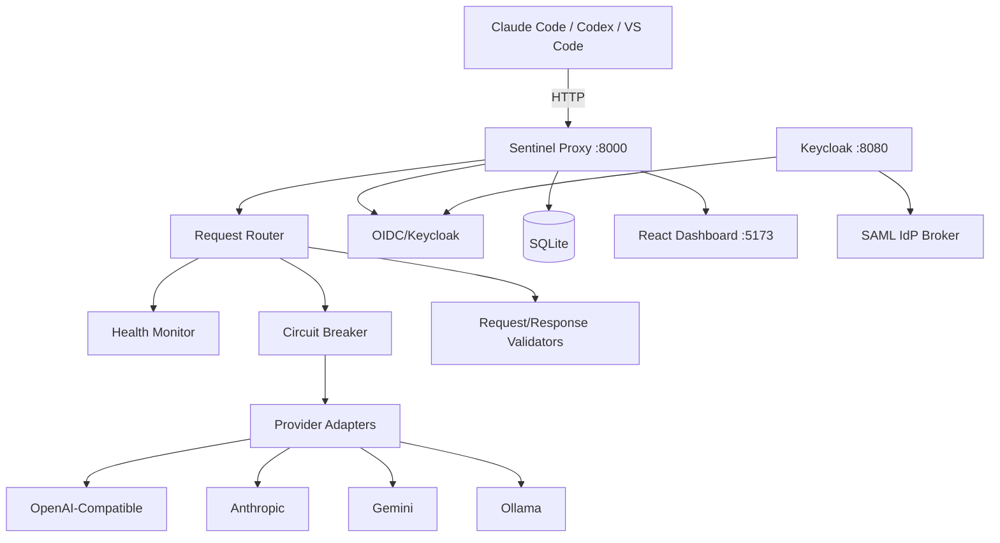

# Sentinel Foundry — Alan Vo

> Work in progress. This checkpoint may be incomplete or fail tests. See PLAN.md and STATUS.md before use.


**Alan Vo | AI & Machine Learning**

A multi-provider AI proxy for developer tools (Claude Code, Codex, VS Code, OpenCode, and more) providing robust free-tier access with health monitoring, automatic failover, and request validation.

## Problem

Developers using AI coding assistants face frequent provider failures: "Provider API request failed" errors, empty/malformed responses, model refresh failures, and timeouts. These issues stem from unreliable free-tier endpoints, rate limits, and lack of failover mechanisms.

## Solution

Sentinel Foundry acts as an intelligent proxy that:
- **Routes requests** across multiple LLM providers (OpenAI-compatible, Anthropic, Gemini, Ollama)
- **Monitors health** continuously and fails over automatically
- **Validates requests/responses** to catch malformed payloads before they reach the client
- **Persists sessions** so conversations survive restarts
- **Provides observability** via a React dashboard showing provider status and request logs

## AI/ML Evaluation

The core routing engine uses a deterministic **weighted round-robin with circuit breaker** algorithm:
- Providers scored by latency (p50), error rate (5min window), and availability
- Circuit breaker opens after 5 consecutive failures, half-open after 30s
- Fallback chain: primary → secondary → tertiary → local (Ollama)

**Reproducible baseline** (run with `make bench`):
```bash
# Synthetic load test against configured providers
python -m sentinel.bench --requests 100 --concurrency 10
```

**Metrics tracked**:
- Request success rate (target: >99%)
- p50/p95/p99 latency
- Failover frequency
- Circuit breaker state transitions

**Failure cases documented**:
- Provider returns 200 with empty body → caught by response validator
- Provider returns non-JSON → caught by parser, triggers failover
- Streaming chunk timeout → circuit breaker activates
- All providers down → returns 503 with retry-after header

## Quick Start

### Prerequisites
- Docker & Docker Compose
- Node 24+ (for frontend development)
- Python 3.12+ (for backend development)

### Development

```bash
# Start all services (backend, frontend, Keycloak, database)
docker compose up -d

# View logs
docker compose logs -f backend

# Frontend dev server (with hot reload)
cd frontend && npm install && npm run dev

# Backend dev server (with auto-reload)
cd backend && python -m venv .venv && .venv/bin/pip install -r requirements.txt
.venv/bin/uvicorn app.main:app --reload --host 0.0.0.0 --port 8000
```

### Services
| Service | URL |
|---------|-----|
| Frontend Dashboard | http://localhost:5173 |
| Backend API | http://localhost:8000 |
| API Docs (Swagger) | http://localhost:8000/docs |
| Keycloak Admin | http://localhost:8080/admin |

### Default Credentials
- Keycloak Admin: `admin` / `admin` (change in production!)
- Demo user created on first run: `demo` / `demo`

## Configuration

Copy `.env.example` to `.env` and configure:

```bash
cp .env.example .env
# Edit .env with your provider API keys
```

### Provider Configuration (via Dashboard)
1. Login to frontend dashboard
2. Navigate to **Providers** page
3. Add provider configurations:
   - **OpenAI-compatible**: OpenRouter, LiteLLM, Ollama, vLLM, etc.
   - **Anthropic**: Direct API or proxy
   - **Gemini**: Google AI Studio or Vertex AI
   - **Ollama**: Local models

## Architecture



## API Reference

### Health & Status
- `GET /health` - Liveness probe
- `GET /ready` - Readiness probe (checks DB, providers)
- `GET /api/v1/providers` - List providers with health status
- `GET /api/v1/providers/{id}/health` - Individual provider health

### Provider Management (auth required)
- `POST /api/v1/providers` - Add provider
- `PATCH /api/v1/providers/{id}` - Update provider
- `DELETE /api/v1/providers/{id}` - Remove provider
- `POST /api/v1/providers/{id}/test` - Test provider connectivity

### Chat Completions (Claude Code compatible)
- `POST /v1/messages` - Anthropic messages format (streaming supported)
- `POST /v1/chat/completions` - OpenAI chat completions format

### Sessions
- `GET /api/v1/sessions` - List conversations
- `POST /api/v1/sessions` - Create session
- `GET /api/v1/sessions/{id}` - Get session with messages
- `DELETE /api/v1/sessions/{id}` - Delete session
- `GET /api/v1/sessions/{id}/export` - Export as JSON

### Request Logs
- `GET /api/v1/logs` - Paginated request logs with filters
- `GET /api/v1/logs/stats` - Aggregated statistics

## Security

- **Authentication**: OIDC authorization code flow with PKCE via Keycloak
- **Session Management**: HttpOnly SameSite=Strict cookies with CSRF protection
- **Roles**: `viewer` (read-only), `operator` (manage providers), `admin` (full access)
- **Secrets**: All LLM API keys stored server-side only, never exposed to frontend
- **Demo Mode**: Explicitly enabled via `DEMO_MODE=true`, binds to 127.0.0.1 only, **refused in production**

### SAML Setup (Keycloak Identity Brokering)
1. In Keycloak Admin Console → Identity Providers → Add SAML v2.0
2. Configure IdP metadata / entity ID / SSO URL
3. Map SAML attributes to Keycloak attributes
4. Enable "Trust Email" for verified email claims
5. Set First Login Flow to "first broker login" for user provisioning

## Deployment

### Production Checklist
- [ ] Set strong `SECRET_KEY` (32+ chars)
- [ ] Configure Keycloak with HTTPS and valid certificates
- [ ] Use PostgreSQL instead of SQLite (`DATABASE_URL=postgresql://...`)
- [ ] Set `APP_ENV=production` (disables demo mode)
- [ ] Configure reverse proxy (nginx/Traefik) with TLS termination
- [ ] Set up database backups (`.backup` script in repo)
- [ ] Configure Keycloak SAML broker for enterprise IdP

### Docker Production
```bash
docker compose -f compose.yaml -f compose.prod.yaml up -d
```

### Backup / Restore
```bash
# Backup
docker compose exec backend python -m sentinel.backup --output /data/backup-$(date +%F).sqlite

# Restore
docker compose exec backend python -m sentinel.restore --input /data/backup-2026-01-15.sqlite
```

## Provider Configuration Table

| Provider | Adapter | Auth | Streaming | Models Endpoint |
|----------|---------|------|-----------|-----------------|
| OpenRouter | OpenAI-Compatible | Bearer | Yes | `/models` |
| LiteLLM | OpenAI-Compatible | Bearer | Yes | `/models` |
| Ollama | Ollama Native | None | Yes | `/api/tags` |
| Anthropic Direct | Anthropic Native | Bearer | Yes | `/v1/models` |
| Gemini | Gemini Native | Bearer | Yes | `/models` |
| vLLM | OpenAI-Compatible | Bearer | Yes | `/models` |
| Custom OpenAI | OpenAI-Compatible | Bearer | Configurable | Configurable |

## Development

### Running Tests
```bash
# Backend tests
cd backend && .venv/bin/pytest -v

# Frontend tests
cd frontend && npm test

# Full CI simulation
make test
```

### Code Quality
```bash
# Backend
cd backend && .venv/bin/ruff check . && .venv/bin/mypy app

# Frontend
cd frontend && npm run lint && npm run typecheck
```

## License

MIT License

Copyright (c) 2026 Alan Vo <alanvo@gmail.com>

Permission is hereby granted, free of charge, to any person obtaining a copy
of this software and associated documentation files (the "Software"), to deal
in the Software without restriction, including without limitation the rights
to use, copy, modify, merge, publish, distribute, sublicense, and/or sell
copies of the Software, and to permit persons to whom the Software is
furnished to do so, subject to the following conditions:

The above copyright notice and this permission notice shall be included in all
copies or substantial portions of the Software.

THE SOFTWARE IS PROVIDED "AS IS", WITHOUT WARRANTY OF ANY KIND, EXPRESS OR
IMPLIED, INCLUDING BUT NOT LIMITED TO THE WARRANTIES OF MERCHANTABILITY,
FITNESS FOR A PARTICULAR PURPOSE AND NONINFRINGEMENT. IN NO EVENT SHALL THE
AUTHORS OR COPYRIGHT HOLDERS BE LIABLE FOR ANY CLAIM, DAMAGES OR OTHER
LIABILITY, WHETHER IN AN ACTION OF CONTRACT, TORT OR OTHERWISE, ARISING FROM,
OUT OF OR IN CONNECTION WITH THE SOFTWARE OR THE USE OR OTHER DEALINGS IN THE
SOFTWARE.